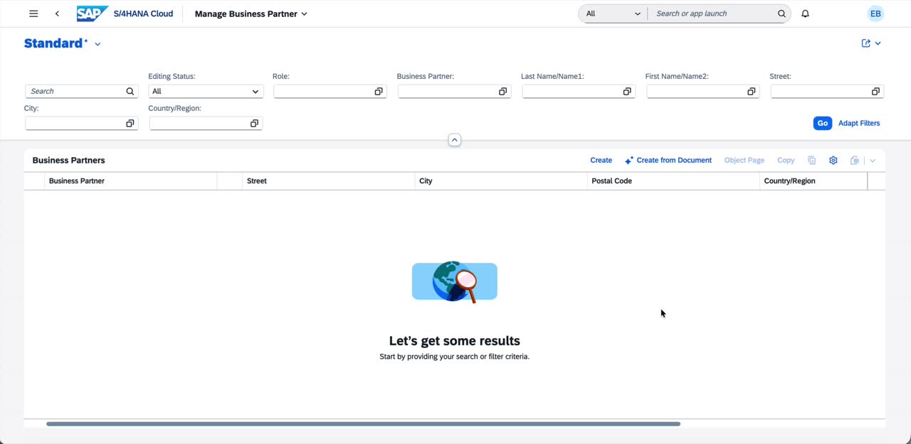
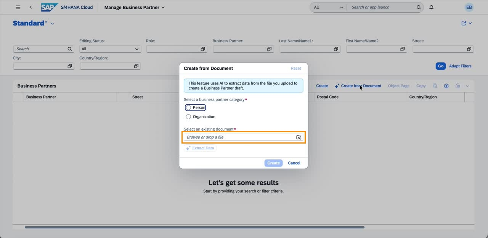
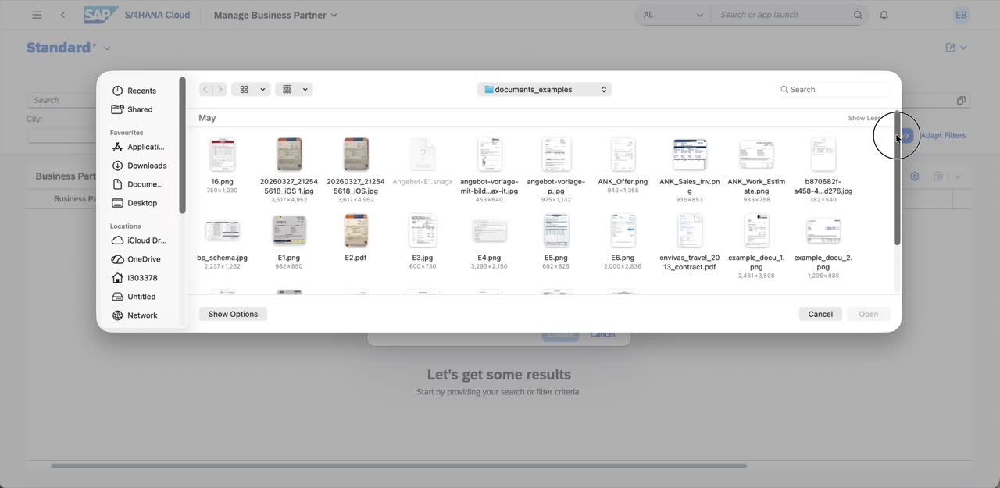
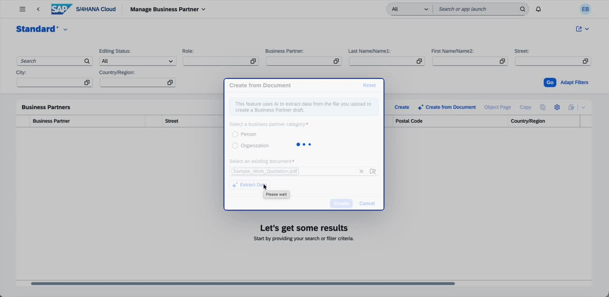
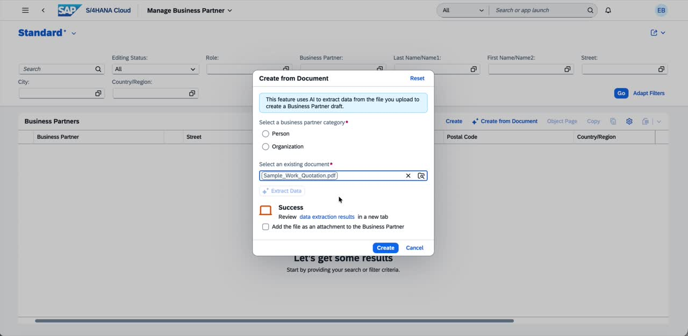
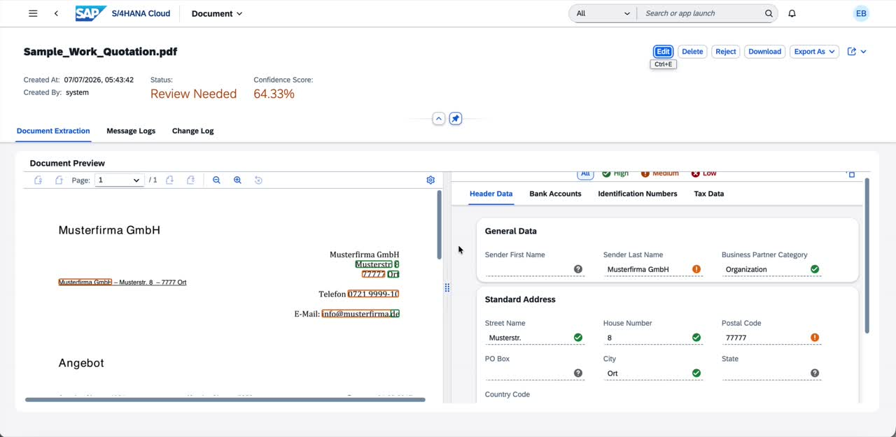
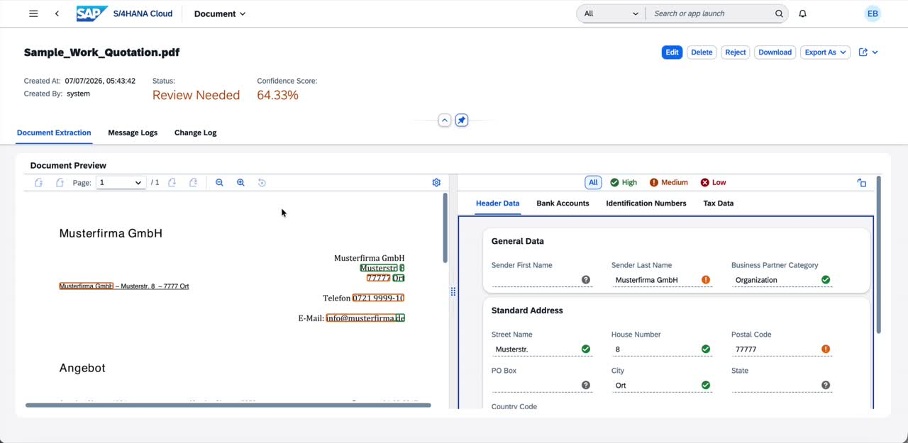
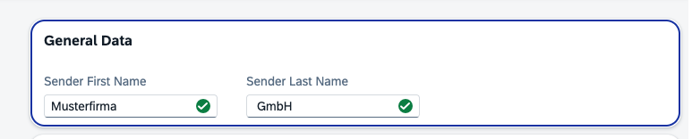
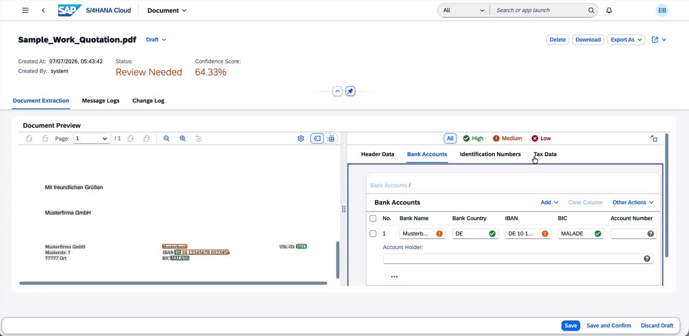
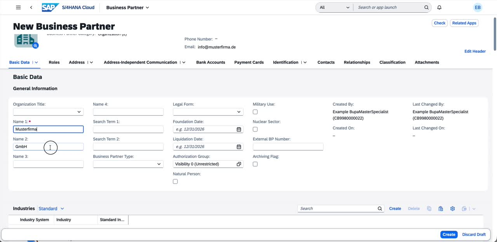

[TechEd2026 - TM262 - Experience Core Foundational Capabilities of SAP Cloud ERP](../../../../#exercises)
# Exercise: AI-Assisted Creation of Business Partner

In this hands-on exercise, you will experience how SAP Document AI can accelerate and simplify the creation of a Business Partner in SAP S/4HANA Cloud. Instead of manually entering data, you will upload a source document — such as a supplier quotation — and let the AI extract relevant fields automatically.

Starting from the **Manage Business Partner Master Data** application, you will initiate a document-based creation flow, upload a sample document, and review the AI-extracted data. You will learn how to validate extraction results, correct field assignments using the Annotation Panel, and confirm the data before creating the Business Partner draft.

This exercise demonstrates how intelligent document processing can reduce manual effort and improve data quality in master data management.

The goal of this exercise is to:
- [Launch the Manage Business Partner application and initiate document-based creation](#launch-manage-business-partner-and-initiate-document-based-creation)
- [Select a source document and extract data](#select-a-source-document-and-extract-data)
- [Review and validate the AI extraction results](#review-and-validate-the-ai-extraction-results)
- [Correct Field Data](#correct-field-data)
- [Review Bank Accounts Data](#review-bank-accounts-data)
- [Save, confirm, and create the Business Partner draft](#save-confirm-and-create-the-business-partner-draft)
- [Verify the pre-filled Business Partner fields](#verify-the-pre-filled-business-partner-fields)

> **Access SAP S/4HANA Public Cloud Edition with the system URL and user credentials provided to you.**  
> [Systems and Logon Information](../../README.md#system-and-logon-information)

---

## Launch Manage Business Partner and Initiate Document-Based Creation

1. Log in to the SAP Fiori Launchpad and navigate to the **Manage Business Partner** application.

2. On the list page, locate the toolbar above the **Business Partners** table. You will see two creation buttons: the standard **Create** button and a new **Create from Document** button (marked with an AI icon).

   > The **Create from Document** button is only visible if your system has been configured with the SAP Document AI subscription for Business Partners.

3. Click on **Create from Document** to open the creation dialog.

   You will be asked to:
   
   - Select an **existing document** to upload

---

## Select a Source Document and Extract Data

4. Under **Select a business partner category**, select **Organization**.

5. Click the browse icon (or drag and drop) in the **Select an existing document** field to open the file picker.

6. Navigate to your local documents folder and select the sample supplier quotation file **Sample_Work_Quotation.pdf**. Click **Open**.

7. Once the file is selected and shown in the document field, click **Extract Data**.

---

## Review and Validate the AI Extraction Results

8. Once the extraction is complete, a **Success** message appears in the dialog. It contains a hyperlink: _"Review data extraction results in a new tab"_.

9. Click the **data extraction results** link to open the extraction review page in a new browser tab.

10. The extraction review page opens, showing the document filename at the top (e.g., **Sample_Work_Quotation.pdf**), along with its current **Status** and overall **Confidence Score**.

    - **Status**: Review Needed
    - **Confidence Score**: 64.33% (this will vary based on document quality)

11. The page is split into two panels:
    - **Left panel**: A preview of the uploaded document
    - **Right panel**: The extracted field values, organized into tabs:
      - **Header Data** (General Data, Standard Address)
      - **Bank Accounts**
      - **Identification Numbers**
      - **Tax Data**

    Each extracted field is shown with a **confidence indicator**:
    - Green (High confidence)
    - Orange (Medium confidence — review recommended)
    - Red (Low confidence — correction required)

   > Notice that **Sender Last Name** shows a medium-confidence (orange) indicator, and **Sender First Name** is empty. The AI has assigned the full name to the Last Name field. In the next section, you will correct this.

---

## Correct Field Data

When the AI extracts data, it may not always assign values to the correct fields. 

12. To correct the field assignment, first click the **Edit** button in the top-right toolbar of the extraction review page to enter edit mode.

13. Once in edit mode, scroll to the **General Data** section in the right panel. Click into the **Sender First Name** field and enter **Musterfirma**. Then click into the **Sender Last Name** field and enter **GmbH**.

14. Verify that the fields have been correctly entered:
    - **Sender First Name** now shows **Musterfirma** with a high-confidence (green) indicator
    - **Sender Last Name** shows **GmbH** with a high-confidence (green) indicator

---

## Review Bank Accounts Data

15. Click on the **Bank Accounts** tab in the right panel.

    The system has automatically detected the following bank account information from the document:

    | Field | Extracted Value |
    |---|---|
    | Bank Name | Musterbank |
    | Bank Country | DE |
    | IBAN | DE 10 12345678 0123456|
    | BIC | MALADE |

   > Verify each field against the source document in the left panel. The IBAN shows a medium-confidence (orange) indicator — if necessary, you can click on the field to correct the value.

---

## Save, Confirm, and Create the Business Partner Draft

16. Once you have reviewed and corrected all extracted fields, click **Save and Confirm** in the footer toolbar.

    > This action saves the document extraction record and marks it as confirmed. The status will change from _Review Needed_ to _Confirmed_.

17. Close the extraction review browser tab and return to the original **Create from Document** dialog.

18. **Optionally**, You can enable the checkbox **Add the file as an attachment to the Business Partner** if you want the source document to be stored alongside the Business Partner record for compliance or audit purposes.

19. Under **Select a business partner category**, confirm that **Person** or **Organization** is selected (this is a mandatory field).

20. Click **Create** to proceed.

---

## Verify the Pre-filled Business Partner Fields

21. The system navigates to the **New Business Partner** object page in edit/draft mode. All fields extracted and confirmed from the document have been pre-populated.

22. If you enabled the attachment option in step 18, click on the **Attachments** tab and confirm that the source document (e.g., **Sample_Work_Quotation.pdf**) is listed as an attachment.

23. Review any remaining fields. You may enrich the Business Partner with additional data if required.

---

## Summary

Congratulations! You have successfully completed the AI-assisted Business Partner creation exercise.

In this exercise, you experienced how SAP Document AI integrates with the **Manage Business Partner** application in SAP S/4HANA Cloud to streamline master data entry. By uploading a vendor quotation document, the system automatically extracted over 20 fields — including general data, address, communication details, bank account information, and tax data — using AI-powered document processing.

Continue to - [Exercise 2: Thumbnail support for product attachments in the Product Master](../ex2/README.md)
