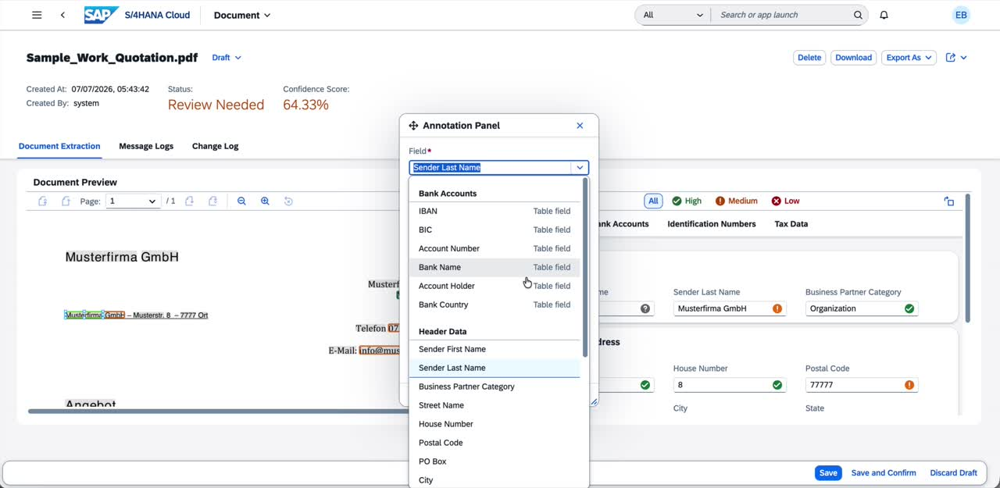
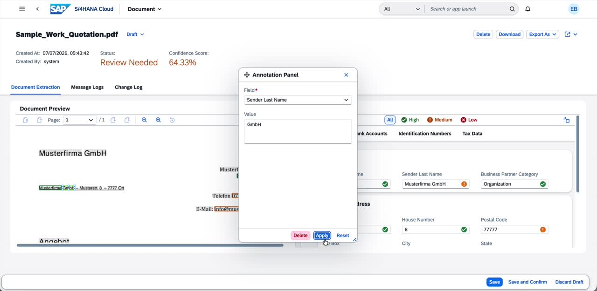
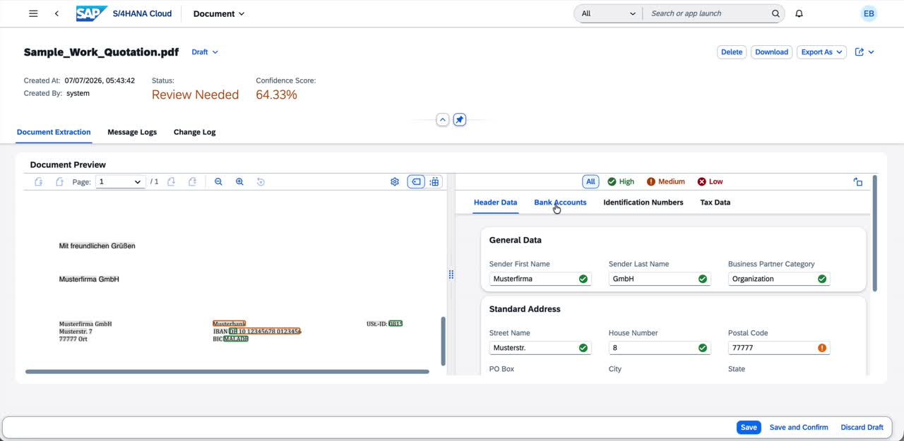
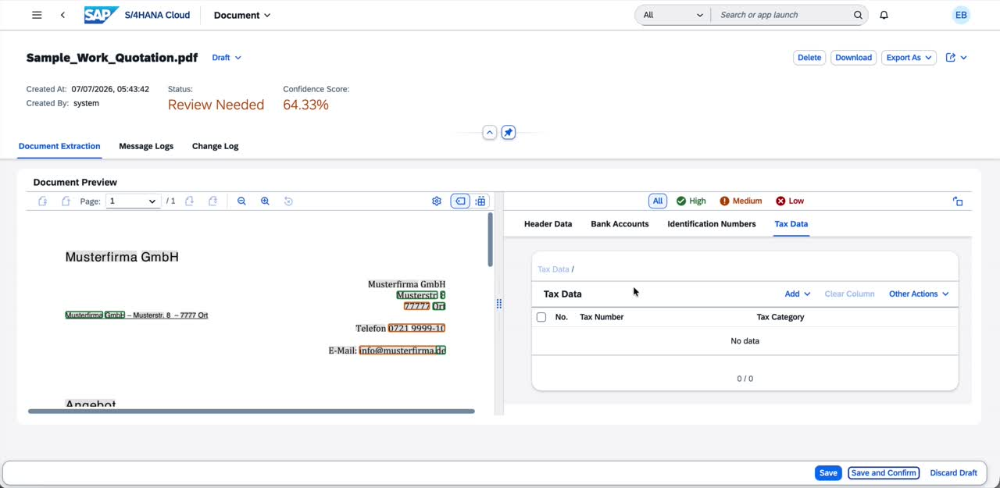
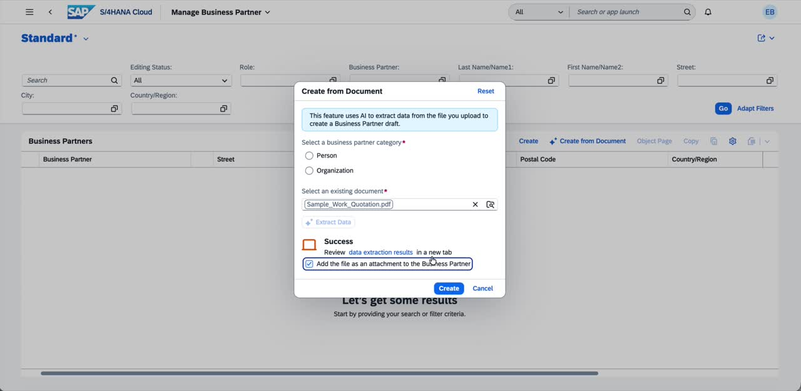
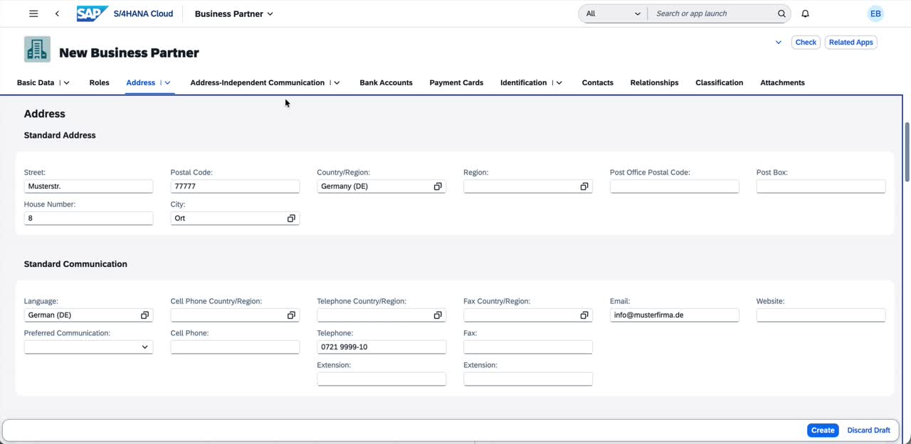
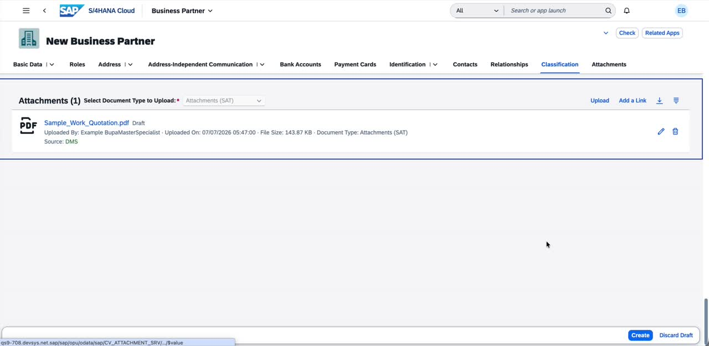

[TechEd2026 - TM262 - Experience Core Foundational Capabilities of SAP Cloud ERP](../../../../#exercises)
# Exercise: AI-Assisted Creation of Business Partner

In this hands-on exercise, you will experience how SAP Document AI can accelerate and simplify the creation of a Business Partner in SAP S/4HANA Cloud. Instead of manually entering data, you will upload a source document — such as a vendor quotation — and let the AI extract relevant fields automatically.

Starting from the **Manage Business Partner** application, you will initiate a document-based creation flow, upload a sample document, and review the AI-extracted data. You will learn how to validate extraction results, correct field assignments using the Annotation Panel, and confirm the data before creating the Business Partner draft.

This exercise demonstrates how intelligent document processing can reduce manual effort and improve data quality in master data management.

The goal of this exercise is to:
- [Launch the Manage Business Partner application and initiate document-based creation](#launch-manage-business-partner-and-initiate-document-based-creation)
- [Select a source document and extract data](#select-a-source-document-and-extract-data)
- [Review and validate the AI extraction results](#review-and-validate-the-ai-extraction-results)
- [Correct field assignments using the Annotation Panel](#correct-field-assignments-using-the-annotation-panel)
- [Review Bank Accounts and Tax Data](#review-bank-accounts-and-tax-data)
- [Save, confirm, and create the Business Partner draft](#save-confirm-and-create-the-business-partner-draft)
- [Verify the pre-filled Business Partner fields](#verify-the-pre-filled-business-partner-fields)

> **Access SAP S/4HANA Public Cloud Edition with the system URL and user credentials provided to you.**  
> [Systems and Logon Information](../../README.md#system-and-logon-information)

---

## Launch Manage Business Partner and Initiate Document-Based Creation

1. Log in to the SAP Fiori Launchpad and navigate to the **Manage Business Partner** application.

2. On the list page, locate the toolbar above the **Business Partners** table. You will see two creation buttons: the standard **Create** button and a new **Create from Document** button (marked with a document AI icon).

   > The **Create from Document** button is only visible if your system has been configured with the SAP Document AI subscription for Business Partners.

3. Click on **Create from Document** to open the creation dialog.

   The dialog displays an information message: _"This feature uses AI to extract data from the file you upload to create a Business Partner draft."_

   You will be asked to:
   - Select a **Business Partner Category** (Person or Organization)
   - Select an **existing document** to upload

---

## Select a Source Document and Extract Data

4. Under **Select a business partner category**, select **Organization**.

5. Click the browse icon (or drag and drop) in the **Select an existing document** field to open the file picker.

6. Navigate to your local documents folder and select the sample vendor quotation file **Sample_Work_Quotation.pdf**. Click **Open**.

7. Once the file is selected and shown in the document field, click **Extract Data**.

---

## Review and Validate the AI Extraction Results

8. Once the extraction is complete, a **Success** message appears in the dialog. It contains a hyperlink: _"Review data extraction results in a new tab"_.

   > You will also notice an optional checkbox: **Add the file as an attachment to the Business Partner**. You can enable this now or later for compliance and traceability purposes.

9. Click the **data extraction results** link to open the extraction review page in a new browser tab.

10. The extraction review page opens, showing the document filename at the top (e.g., **Sample_Work_Quotation.pdf**), along with its current **Status** and overall **Confidence Score**.

    - **Status**: Review Needed
    - **Confidence Score**: 64.33% (this will vary based on document quality)

11. The page is split into two panels:
    - **Left panel**: A preview of the uploaded document
    - **Right panel**: The extracted field values, organized into tabs:
      - **Header Data** (General Data, Standard Address)
      - **Bank Accounts**
      - **Identification Numbers**
      - **Tax Data**

    Each extracted field is shown with a **confidence indicator**:
    - Green (High confidence)
    - Orange (Medium confidence — review recommended)
    - Red (Low confidence — correction required)

12. On the **Header Data** tab, review the **General Data** section. Verify that the following fields have been extracted:

    | Field | Extracted Value |
    |---|---|
    | Sender Last Name | Musterfirma GmbH |
    | Business Partner Category | Organization |

   > Notice that **Sender Last Name** shows a medium-confidence (orange) indicator, and **Sender First Name** is empty. The AI has assigned the full company name to the Last Name field. In the next section, you will correct this.

---

## Correct Field Assignments Using the Annotation Panel

When the AI extracts data, it may not always assign values to the correct fields, especially for company names. The **Annotation Panel** allows you to manually assign text regions from the document to the correct fields.

13. To correct the field assignment, click on the highlighted text region in the **document preview panel** on the left side (the text "Musterfirma GmbH" as highlighted by the extraction engine). The **Annotation Panel** will open as an overlay.

14. In the **Annotation Panel**, use the **Field** dropdown to view all supported fields. The system supports 20+ fields across the following groups:
    - **Bank Accounts**: IBAN, BIC, Account Number, Bank Name, Account Holder, Bank Country
    - **Header Data**: Sender First Name, Sender Last Name, Business Partner Category, Street Name, House Number, Postal Code, PO Box, City, State, Country Code, Language, Phone Number, Email, and more

15. Change the **Field** from _Sender Last Name_ to **Sender First Name**.

16. In the **Value** field, enter the correct value (e.g., **Musterfirma**) to assign as the first name/company name part.

17. Click **Apply**. The Annotation Panel closes and the extracted field values are updated. Observe that:
    - **Sender First Name** now shows **Musterfirma** with a high-confidence (green) indicator
    - **Sender Last Name** shows **GmbH** with a high-confidence (green) indicator

---

## Review Bank Accounts and Tax Data

18. Click on the **Bank Accounts** tab in the right panel.

    The system has automatically detected the following bank account information from the document:

    | Field | Extracted Value |
    |---|---|
    | Bank Name | Musterbank... |
    | Bank Country | DE |
    | IBAN | DE 10 1... |
    | BIC | MALADE |

   > Verify each field against the source document in the left panel. The IBAN shows a medium-confidence (orange) indicator — if necessary, you can click on the field to correct the value.

19. Click on the **Tax Data** tab to review any tax-related information extracted.

    > In some cases, the AI may incorrectly identify a value as a tax number when it is not. If any entries in the Tax Data table are incorrect, select the corresponding row and delete it using the row-level actions.

---

## Save, Confirm, and Create the Business Partner Draft

20. Once you have reviewed and corrected all extracted fields, click **Save and Confirm** in the footer toolbar.

    > This action saves the document extraction record and marks it as confirmed. The status will change from _Review Needed_ to _Confirmed_.

21. Close the extraction review browser tab and return to the original **Create from Document** dialog.

22. The dialog now shows a **Success** message confirming that the extraction is complete.

    Optionally, enable the checkbox **Add the file as an attachment to the Business Partner** if you want the source document to be stored alongside the Business Partner record for compliance or audit purposes.

23. Under **Select a business partner category**, confirm that **Organization** is selected (this is a mandatory field).

24. Click **Create** to proceed.

---

## Verify the Pre-filled Business Partner Fields

25. The system navigates to the **New Business Partner** object page in edit/draft mode. All fields extracted and confirmed from the document have been pre-populated.

26. On the **Basic Data** tab, verify the **General Information** section:

    | Field | Pre-filled Value |
    |---|---|
    | Name 1 | Musterfirma |
    | Name 2 | GmbH |
    | Business Partner Category | Organization (2) |

27. Click on the **Address** tab. Verify that the **Standard Address** fields have been populated correctly from the extracted data:

    | Field | Pre-filled Value |
    |---|---|
    | Street | Musterstr. |
    | House Number | 8 |
    | Postal Code | 77777 |
    | City | Ort |
    | Country/Region | Germany (DE) |

    Also verify the **Standard Communication** section:

    | Field | Pre-filled Value |
    |---|---|
    | Language | German (DE) |
    | Telephone | 0721 9999-10 |
    | Email | info@musterfirma.de |

28. Click on the **Bank Accounts** tab to verify that the bank details extracted from the document have been carried over into the Business Partner draft.

29. If you enabled the attachment option in step 22, click on the **Attachments** tab and confirm that the source document (e.g., **Sample_Work_Quotation.pdf**) is listed as an attachment.

30. Review any remaining fields. You may enrich the Business Partner with additional data if required.

31. When you are satisfied with the data, click **Create** to save the Business Partner as an active record, or click **Discard Draft** to abandon the creation.

---

## Summary

Congratulations! You have successfully completed the AI-assisted Business Partner creation exercise.

In this exercise, you experienced how SAP Document AI integrates with the **Manage Business Partner** application in SAP S/4HANA Cloud to streamline master data entry. By uploading a vendor quotation document, the system automatically extracted over 20 fields — including general data, address, communication details, bank account information, and tax data — using AI-powered document processing.

Continue to - [Exercise 2: Thumbnail support for product attachments in the Product Master](../ex2/README.md)
